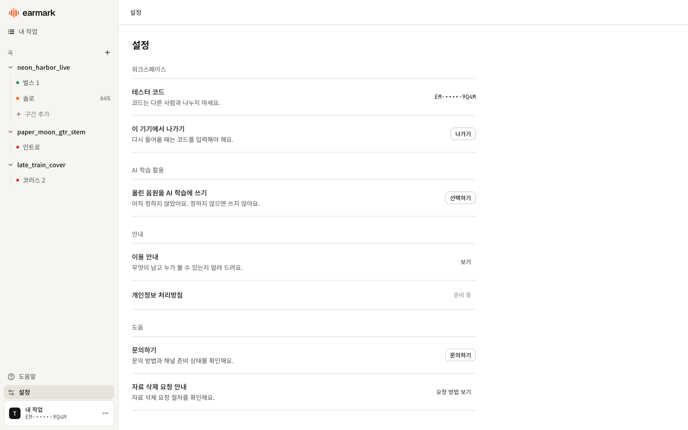
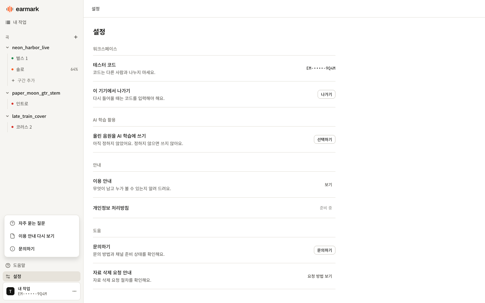
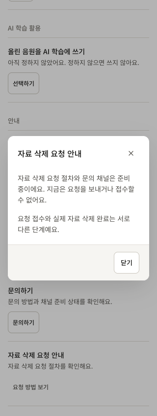

# 설정·도움말·작업 접근 복구 검토

2026-11-04 · [이슈 #9](https://github.com/capstoneBU-02/capstoneBu-2026-FE/issues/9) · `feature/9-settings-support-mock`

설정에서 동의를 변경하고 나갈 수 있으며, 도움말 메뉴에서 FAQ·이용 안내·문의 안내를 열 수 있다. 없는 작업과 접근할 수 없는 작업에는 같은 안내와 내 작업 복귀 버튼을 제공한다. [구현 계획과 정책 근거](settings-support-plan.md)에 따라 실제 API 대신 기존 메모리 목업을 사용했다. **독립 리뷰와 PR CI 결과를 보고한 뒤 사용자 리뷰를 기다리며, 사용자 리뷰 전에는 병합하지 않는다.**

## 화면 증거

설정은 현재 코드의 마스킹 값과 동의 상태를 보여 준다. 목록·설정의 상태를 공유하고 기존 동의 변경 모달을 재사용한다.

도움말은 별도 페이지 대신 현재 화면 위 메뉴로 제공한다. 메뉴 선택 후 안내 모달이 열리고, 닫으면 도움말 버튼으로 포커스를 돌린다. 모바일에서는 닫힌 탐색 영역 대신 탐색 메뉴 열기 버튼으로 복원한다.

삭제 요청은 안내만 읽고 닫을 수 있다. 실제 요청·접수·삭제 완료를 표시하지 않는다.

## Figma·반응형 확인

[설정 86:2926](https://www.figma.com/design/87W9ZPWGTWqNHX7HTfQ1kZ?node-id=86-2926), [도움말 86:3169](https://www.figma.com/design/87W9ZPWGTWqNHX7HTfQ1kZ?node-id=86-3169), [접근 불가 86:2698](https://www.figma.com/design/87W9ZPWGTWqNHX7HTfQ1kZ?node-id=86-2698)의 실화면·컨텍스트와 비교했다.

| 대상                    | 실제 브라우저 측정          | 확인 결과                                   |
| ----------------------- | --------------------------- | ------------------------------------------- |
| 설정 본문 / 1440px      | x276, y80, 폭720px          | 사이드바248px + 본문 여백28px, 원본 폭 일치 |
| 도움말 메뉴 / 1440px    | x12, y638, 224×126px        | 원본 위치·크기 일치                         |
| 접근 불가 카드 / 1440px | x564, y335, 560×282px       | 원본 위치·크기 일치                         |
| 설정 / 390·320px        | 본문 폭358·288px, 좌우16px  | 액션을 다음 행으로 배치, 가로 넘침 없음     |
| 안내 모달 / 320×480px   | top16, bottom464, 높이448px | 긴 내용은 내부 스크롤, 화면 밖 조작 없음    |

기존 자체 호스팅 Noto Sans KR·Geist·JetBrains Mono가 실제 렌더에 쓰이는 것을 Chrome CDP로 확인했다. 원본 SVG 4개는 16/20px 크기를 유지했다. 모바일 조작은 44px 높이를 확보했다. 모바일·개별 안내 모달은 별도 Figma 프레임이 없어 기존 카드·모달의 시각 규칙을 적용했다.

이용 안내는 최초 온보딩과 같은 본문 컴포넌트를 사용하며, 재열람은 확인 플래그나 동의를 변경하지 않는다. Escape·닫기·native close·backdrop 종료, 메뉴 키보드 이동, 숨겨진 복귀 대상의 main 대체 포커스를 검증했다.

## 실행 검사와 리뷰 상태

| 검사                                             | 실제 결과                                                                     |
| ------------------------------------------------ | ----------------------------------------------------------------------------- |
| `npm run check`                                  | P2 수정 후 통과. Prettier·oxlint·단위 테스트 16/16·TypeScript·프로덕션 빌드   |
| `PLAYWRIGHT_CHANNEL=chrome npm run test:browser` | 최종 34/34 통과, 41.9초. 기존 31개 + selector 회귀 3개                        |
| P2 대상 회귀 검사                                | 수정 전 2실패·1통과 → 수정 후 3/3 통과, 5.0초                                 |
| UI 브라우저 QA                                   | 1440/390/320px 25개 캡처, 가로 넘침 0·pageerror 0, 포커스 복원 13건 통과      |
| 추가 모달 QA                                     | 320×480px 내부 스크롤, 내부→backdrop 드래그 유지, 배경 컨트롤로 Tab 이동 없음 |
| 보안 검토                                        | 확정된 보안 지적 0건                                                          |
| 독립 TypeScript 리뷰                             | P2 수정 확인 후 APPROVE. 확정된 잔여 지적 0건                                 |
| 독립 일반 코드 리뷰                              | 수정 확인 후 APPROVE. 확정된 잔여 지적 0건                                    |
| PR CI                                            | 커밋 전이므로 대기. 최종 PR HEAD의 결과는 PR 본문/Checks에서 보고             |

최종 자동 검사 원본은 `/private/tmp/earmark-issue9/check-after-selector.log`, `browser-after-selector.log`, P2 수정 전후 회귀 기록은 같은 디렉터리의 `selector-before.log`, `selector-after.log`에 보존했다. 프로덕션 빌드 결과는 JS 256.91kB(gzip 76.79kB), CSS 70.09kB(gzip 20.19kB)이며 빌드 시간은 129ms다. UI 원본 25장과 정량 기록은 `outputs/earmark-settings-support-2026-11-04/`에 있고, 위 대표 3장은 PR에서 바로 볼 수 있도록 저장소에 포함했다. 문서 마무리 후에는 해당 Markdown 포맷과 diff만 검사하며 전체 테스트를 반복하지 않는다.

독립 리뷰에서 과거 `demo` 쿼리가 다른 코드의 새 세션에서도 남아 새로고침 시 미리보기를 복원하는 P2를 확인했다. 진입 시 선택한 모드를 기준으로 URL을 정리하도록 수정했고, history 이동·재진입·새로고침을 다루는 회귀 3개가 통과했다. TypeScript·일반 코드 리뷰 모두 수정과 최종 검사를 확인해 승인했다.

## PR 리뷰 반영 (2026-11-05)

PR 리뷰와 그 검증에서 병합 전 수정으로 분류한 항목을 반영했다.

| 지적                                           | 수정                                                                                                          | 회귀 검사                                                            |
| ---------------------------------------------- | ------------------------------------------------------------------------------------------------------------- | -------------------------------------------------------------------- |
| 건너뛰기 링크가 설정 등을 홈으로 바꿈          | hash 이동을 막고 main에 포커스·스크롤만 한다. 문구를 "본문으로 건너뛰기"로 바꿨다                             | 네 화면의 URL·제목·history 유지, 모바일 스크롤                       |
| 비보안 HTTP(LAN IP)에서 `randomUUID` 없음      | 세션 표식을 `crypto.getRandomValues` 16바이트로 만든다                                                        | API가 없을 때 미리보기·일반 진입, 재진입 시 다른 표식                |
| `URLSearchParams.size` 미지원 브라우저         | `params.toString()`의 빈 문자열 여부로 쿼리를 붙인다                                                          | 단위 테스트, API가 없을 때 history·나가기의 selector 유지            |
| 모바일 빈 목록에서 도움말 메뉴가 잘림          | 700px 이하에서는 메뉴를 드로어 흐름 안에 둔다                                                                 | empty·신규 코드·작업 있음 × 390×844·320×480, 세 항목 터치·키보드     |
| 화면 이동 뒤 늦은 동의 저장 실패가 보이지 않음 | 창이 닫힌 뒤 실패하면 현재 화면에 알림과 "AI 학습 활용 다시 선택"을 보여 준다. 다시 열면 실패 내용을 유지한다 | Back·native close 뒤 실패, 재시도, 기존 선택 보존, 새 작업 공간 격리 |
| 화면 전환 때 사이드바가 2px 이동               | "내 작업" 행 높이를 선택 여부와 상관없이 고정한다                                                             | 1440·390px에서 home·settings·task-not-found의 행 좌표·높이 비교      |
| `SupportTopic`·`HelpTopic` 중복 선언           | 기존 export 타입을 가져다 쓴다                                                                                | typecheck                                                            |

같은 홈 재선택의 필터 초기화와 복구 버튼의 history 방식은 정책을 정한 뒤 처리한다. 미리보기 새로고침의 홈 초기화는 새 세션 정책과 일치하여 유지한다. history·모달 공통화 같은 구조 개선은 후속 작업으로 둔다.

리뷰 반영 후 `npm run check`(단위 테스트 17/17 포함)와 Chrome 브라우저 테스트 53/53이 통과했다. 비보안 HTTP와 `size` 미지원은 Chrome에서 해당 API를 제거한 시뮬레이션이며, Safari 16 실기와 실제 LAN 기기 결과는 아니다.

## 목업 한계와 남은 작업

- 코드·자료·동의는 메모리에만 유지한다. URL/history에는 제출 코드·자료를 기록하지 않고, 세션 범위 표식으로 화면 복원을 제한한다. 실제 서버 인증·권한 검증은 별도 구현이다.
- 문의 채널·개인정보 처리방침·코드 재발급 절차는 준비 중이다. 실제 메일 전송·문의 접수·자료 삭제·코드 폐기 기능은 없다.
- 정상 작업 상세·업로드·오디오·악보·녹음·비교는 후속 범위다. 정상 작업을 접근 실패 화면으로 연결하지 않는다.
- 보관 기간·삭제 처리·문의 운영 정책을 이번 화면으로 확정하지 않는다. 기존 동의의 임시 기간도 정책 확정이 필요하다.
- 독립 리뷰의 확정 지적은 해결했다. 최종 PR HEAD의 CI 결과를 PR 본문/Checks에서 보고한다. **병합은 사용자 리뷰 전까지 보류한다.**
